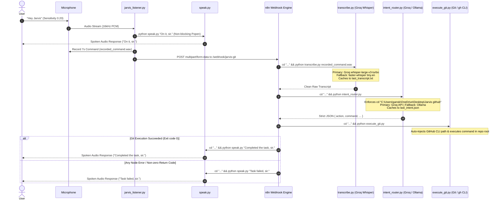

# Jarvis - High-Speed Voice Git & GitHub Automation

Zero-cost, local voice assistant that translates spoken natural language into deterministic Git and GitHub CLI actions using **openWakeWord** (Sensitivity: 0.20), **Groq Cloud Whisper (`whisper-large-v3-turbo`)**, **Groq LLM** (with local **Ollama `qwen2.5-coder:7b`** fallback), and **n8n**.

---

## Architecture Flow



---

## Component Architecture

1. [`jarvis_listener.py`](file:///c:/Users/gansk/OneDrive/Desktop/Jarvis%20github/jarvis_listener.py):
   - **Wake Word Sensitivity**: Threshold `0.20` for conversational speech triggering.
   - **Non-blocking Acknowledgment**: Fires `python speak.py "On it, sir."` asynchronously via `subprocess.Popen`.
   - **7-Second Command Recording**: Prevents cut-offs during longer instructions.
   - **Multipart Webhook Dispatch**: Posts to `http://localhost:5678/webhook/jarvis-git`.
2. [`transcribe.py`](file:///c:/Users/gansk/OneDrive/Desktop/Jarvis%20github/transcribe.py):
   - **Primary ASR**: Groq Cloud API `whisper-large-v3-turbo` for sub-100ms transcription.
   - **Offline Fallback**: Local `faster-whisper` (`tiny.en`, `int8`).
   - Caches clean transcript to `last_transcript.txt`.
3. [`intent_router.py`](file:///c:/Users/gansk/OneDrive/Desktop/Jarvis%20github/intent_router.py):
   - **Working Directory Enforced**: Every generated CLI command starts with `cd "C:\Users\gansk\OneDrive\Desktop\Jarvis github" && ...`.
   - **Repo Creation Fallback**: When pushing or creating a repo, initializes Git, commits, and creates public GitHub repo via `gh repo create "Jarvis-Voice-Assistant" --public --source=. --remote=origin --push`.
   - **Primary LLM**: Groq Cloud API.
   - **Offline Fallback**: Local Ollama `qwen2.5-coder:7b`.
4. [`execute_git.py`](file:///c:/Users/gansk/OneDrive/Desktop/Jarvis%20github/execute_git.py):
   - Injects `C:\Program Files\GitHub CLI` into `PATH`.
   - Reads `last_intent.json` and executes the command inside the absolute project root.
   - Returns genuine exit code (0 on success, non-zero on failure).
5. [`speak.py`](file:///c:/Users/gansk/OneDrive/Desktop/Jarvis%20github/speak.py):
   - Windows PowerShell native `SpeechSynthesizer` with `pyttsx3` offline fallback.
6. [`workflows/jarvis_workflow.json`](file:///c:/Users/gansk/OneDrive/Desktop/Jarvis%20github/workflows/jarvis_workflow.json):
   - 6-node chained n8n workflow with directory switching (`cd "C:\Users\gansk\OneDrive\Desktop\Jarvis github" && ...`) and error routing (`continueErrorOutput`).

---

## Running the System

```powershell
# 1. Run n8n (if not already running)
npm run n8n

# 2. Run Voice Listener
python jarvis_listener.py
```
