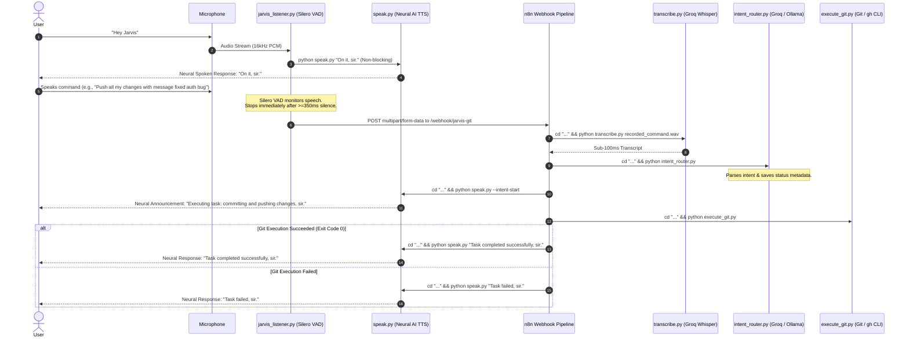

# Jarvis - Real-Time Conversational Voice Git Automation

Zero-cost, local, zero-latency voice assistant that automates Git and GitHub CLI operations using **openWakeWord** (Sensitivity: 0.20), **Silero VAD** (Ultra-responsive >=350ms silence cutoff), **Groq Whisper (`whisper-large-v3-turbo`)**, **Groq LLM** (with local **Ollama `qwen2.5-coder:7b`** fallback), **Neural AI TTS (`edge-tts` with `en-US-ChristopherNeural`)**, and **n8n**.

---

## Conversational Voice Architecture



---

## Component Architecture

1. [`jarvis_listener.py`](file:///c:/Users/gansk/OneDrive/Desktop/Jarvis%20github/jarvis_listener.py):
   - **Wake Word Detection**: `openWakeWord` (`hey_jarvis`, Sensitivity: 0.20).
   - **Immediate Wake Acknowledgment**: Calls `python speak.py "On it, sir."` non-blocking.
   - **Ultra-Low Latency Silero VAD**: Automatically stops recording within 350ms of trailing silence.
   - **Multipart Webhook Dispatch**: Posts to `http://localhost:5678/webhook/jarvis-git`.
2. [`speak.py`](file:///c:/Users/gansk/OneDrive/Desktop/Jarvis%20github/speak.py):
   - **Single Cache File**: Reuses `temp_speech.mp3` for zero disk bloating.
   - **24kHz Pre-initialized Player**: `pygame.mixer` pre-initialized at native 24000Hz for sub-50ms playback.
   - **Neural Voice**: Exclusive `en-US-ChristopherNeural` (deep cinematic Jarvis tone).
3. [`transcribe.py`](file:///c:/Users/gansk/OneDrive/Desktop/Jarvis%20github/transcribe.py):
   - Primary: Groq Cloud API `whisper-large-v3-turbo` for sub-100ms transcription.
   - Fallback: Local `faster-whisper` (`tiny.en`, `int8`).
4. [`intent_router.py`](file:///c:/Users/gansk/OneDrive/Desktop/Jarvis%20github/intent_router.py):
   - Extracts structured action and CLI command (with `cd "C:\Users\gansk\OneDrive\Desktop\Jarvis github"`).
   - Pure parser: no internal duplicate speech invocations.
5. [`execute_git.py`](file:///c:/Users/gansk/OneDrive/Desktop/Jarvis%20github/execute_git.py):
   - Auto-injects `C:\Program Files\GitHub CLI` into `PATH`.
   - Runs the command inside repository root and returns exact exit code.
6. [`workflows/jarvis_workflow.json`](file:///c:/Users/gansk/OneDrive/Desktop/Jarvis%20github/workflows/jarvis_workflow.json):
   - Streamlined 7-node chained workflow with exactly one start announcement and one completion announcement.

---

## Running Jarvis

```powershell
# 1. Start n8n Server (Terminal 1)
.\start_n8n.bat

# 2. Start Jarvis Listener (Terminal 2)
.\start_jarvis.bat
```
