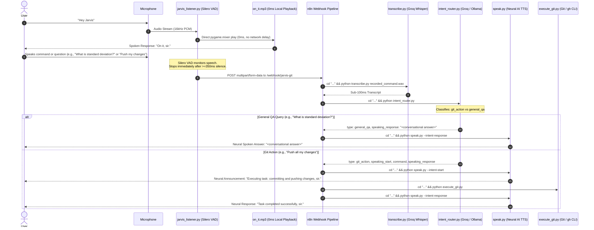

# Jarvis - Real-Time General-Purpose Voice AI & Git Automation

Zero-cost, local, zero-latency voice assistant that handles **both Git operations AND general conversational AI queries** (Q&A, explanations, reasoning) using **openWakeWord** (Sensitivity: 0.20), **0ms Pre-rendered Local Acknowledgment**, **Silero VAD** (350ms silence cutoff), **Groq Whisper (`whisper-large-v3-turbo`)**, **Groq LLM (`llama-3.3-70b-versatile`)**, **Neural AI TTS (`edge-tts` with `en-US-ChristopherNeural`)**, and **n8n**.

---

## Conversational Voice Architecture



---

## Component Architecture

1. [`jarvis_listener.py`](file:///c:/Users/gansk/OneDrive/Desktop/Jarvis%20github/jarvis_listener.py):
   - **0ms Instant Wake Acknowledgment**: Plays pre-rendered `on_it.mp3` directly via `pygame.mixer` inside the listener process (zero network or subprocess overhead).
   - **Dynamic Silero VAD**: Automatically stops recording within 350ms of trailing silence.
   - **Multipart Webhook Dispatch**: Posts to `http://localhost:5678/webhook/jarvis-git`.
2. [`intent_router.py`](file:///c:/Users/gansk/OneDrive/Desktop/Jarvis%20github/intent_router.py):
   - **Dual AI Intent Classification**: Seamlessly routes between `git_action` and `general_qa`.
   - **Concise Spoken Answers**: Produces natural 1-2 sentence spoken answers for general queries.
   - **Primary Engine**: Groq Cloud API (`llama-3.3-70b-versatile`). Fallback: Local Ollama (`qwen2.5-coder:7b`).
3. [`speak.py`](file:///c:/Users/gansk/OneDrive/Desktop/Jarvis%20github/speak.py):
   - Pre-rendered static clips: `on_it.mp3` and `listening.mp3`.
   - Pre-warmed 24kHz `pygame.mixer` player for sub-50ms dynamic playback.
   - Reuses single `temp_speech.mp3` cache file.
4. [`execute_git.py`](file:///c:/Users/gansk/OneDrive/Desktop/Jarvis%20github/execute_git.py):
   - Injects GitHub CLI into PATH.
   - Bypasses execution automatically on `general_qa` queries.
5. [`workflows/jarvis_workflow.json`](file:///c:/Users/gansk/OneDrive/Desktop/Jarvis%20github/workflows/jarvis_workflow.json):
   - 9-node workflow with conditional IF node branching Git actions vs direct conversational QA answers.

---

## Running Jarvis

```powershell
# 1. Start n8n Server (Terminal 1)
.\start_n8n.bat

# 2. Start Jarvis Listener (Terminal 2)
.\start_jarvis.bat
```
