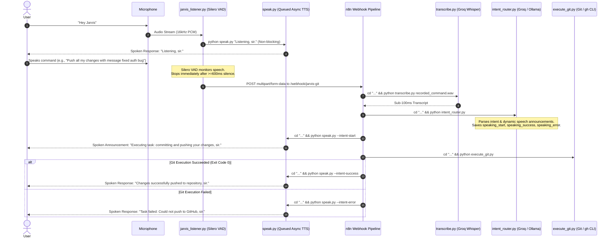

# Jarvis - Real-Time Conversational Voice Git Automation

Zero-cost, local, zero-latency voice assistant that automates Git and GitHub CLI operations using **openWakeWord** (Sensitivity: 0.20), **Silero VAD** (Dynamic >=600ms silence boundary detection), **Groq Whisper (`whisper-large-v3-turbo`)**, **Groq LLM** (with local **Ollama `qwen2.5-coder:7b`** fallback), and **n8n**.

---

## Conversational Voice Architecture



---

## Component Architecture

1. [`jarvis_listener.py`](file:///c:/Users/gansk/OneDrive/Desktop/Jarvis%20github/jarvis_listener.py):
   - **Wake Word Detection**: `openWakeWord` (`hey_jarvis`, Sensitivity: 0.20).
   - **Immediate Confirmation**: Calls `python speak.py "Listening, sir."` non-blocking.
   - **Dynamic Silero VAD**: Automatically stops recording when trailing silence >= 600ms (no more fixed waits!).
   - **Multipart Webhook Dispatch**: Posts to `http://localhost:5678/webhook/jarvis-git`.
2. [`speak.py`](file:///c:/Users/gansk/OneDrive/Desktop/Jarvis%20github/speak.py):
   - **Asynchronous Queue Engine**: CLI commands return in <20ms while background worker speaks announcements in order without overlap or cutting each other off.
   - **Flags**: `--intent-start`, `--intent-success`, `--intent-error`, `--file <path>`.
3. [`transcribe.py`](file:///c:/Users/gansk/OneDrive/Desktop/Jarvis%20github/transcribe.py):
   - Primary: Groq Cloud API `whisper-large-v3-turbo` for sub-100ms transcription.
   - Fallback: Local `faster-whisper` (`tiny.en`, `int8`).
4. [`intent_router.py`](file:///c:/Users/gansk/OneDrive/Desktop/Jarvis%20github/intent_router.py):
   - Extracts structured action, CLI command (with `cd "C:\Users\gansk\OneDrive\Desktop\Jarvis github"`), and dynamic status speech phrases (`speaking_start`, `speaking_success`, `speaking_error`).
5. [`execute_git.py`](file:///c:/Users/gansk/OneDrive/Desktop/Jarvis%20github/execute_git.py):
   - Auto-injects `C:\Program Files\GitHub CLI` into `PATH`.
   - Runs the command inside repository root and returns exact exit code.
6. [`workflows/jarvis_workflow.json`](file:///c:/Users/gansk/OneDrive/Desktop/Jarvis%20github/workflows/jarvis_workflow.json):
   - 7-node chained workflow including task start announcement, git execution, and dynamic success/error spoken routing.

---

## Running Jarvis

```powershell
# 1. Start n8n Server (Terminal 1)
.\start_n8n.bat

# 2. Start Jarvis Listener (Terminal 2)
.\start_jarvis.bat
```
